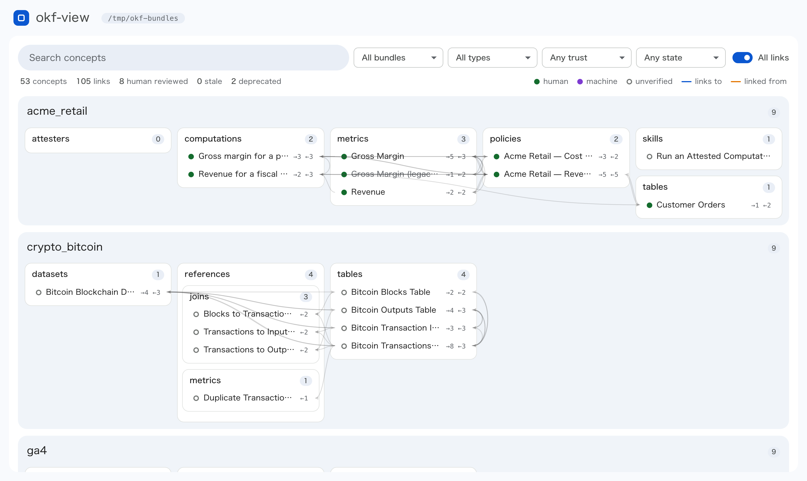

# okf-view

Browse [Open Knowledge Format (OKF)](https://github.com/GoogleCloudPlatform/open-knowledge-format) bundles in the browser. Read-only: it never modifies bundle files.

<picture>
  <source media="(prefers-color-scheme: dark)" srcset="docs/images/screenshot-dark.webp">
  
</picture>

The bundles shown are the [samples from the OKF repository](https://github.com/GoogleCloudPlatform/open-knowledge-format/tree/main/bundles).

- **Map.** Every bundle at a glance: directories as nested boxes, concepts in them marked with their trust tier (OKF §5.3) and staleness, and how many links each has. Pointing at or opening a concept draws arrows to what it links to and from what links to it; "All links" draws every link.
- **Search and filters.** Search titles, descriptions, bodies and tags; filter by bundle, `type`, trust tier, and stale, deprecated or malformed concepts. Concepts that don't match fade on the map.
- **Side sheet.** Opening a concept or directory shows it in a sheet beside the map, which stays in view; Esc closes it, and the button in its header or M maximizes it to the whole window and restores it. A concept's frontmatter (`verified`, `generated`, `stale_after`, tags, `sources`), its body rendered as Markdown with `（source: <id>）` citations linked to their sources, and the concepts it links to and that link to it. A directory shows its `index.md` and contents, lists the files in it that aren't concepts, and links to its `log.md`.
- **Links.** Links within a bundle open in the viewer, including those starting with `/`, which OKF resolves from the bundle root. Links to files that aren't concepts open them as they are, HTML in a sandbox. Links to missing files are marked.

Bundles are read again on each page load and whenever the tab comes back into view, so edits show up without a restart.

## Install

Download a prebuilt binary from [GitHub Releases](https://github.com/yokonao/okf-view/releases).
Every release ships with a build provenance attestation.

See [docs/install.md](docs/install.md) for other install methods and how to verify a release.

## Browse

```
okf-view serve [dir] [--addr ADDR] [--no-open]
```

Serves the bundles directly under `dir` (each directory, or link to one, is a bundle named after it), or `dir` itself when it has an `index.md`. `dir` defaults to `$OKF_DIR`; a leading `~` means your home directory.

Starts a local web server (a random port on `127.0.0.1` by default), opens it in the browser, and serves until interrupted.

`--addr unix:///absolute/path.sock` listens on a Unix socket instead, in the form [devproxy](https://github.com/yokonao/devproxy) takes for its targets, so it can be served as `<route>.localhost`. The browser isn't opened then.

Inside a bundle, a link to a directory is followed only when it stays within the bundle; the overview lists any it skipped.

## Links into sibling bundles

okf-view resolves one kind of link that OKF v0.2 leaves undefined. A relative link that leaves its bundle by one level, such as `../kakeibo/accounts/index.md`, opens in the bundle named `kakeibo` when `serve` loaded it from the same directory, and links between concepts this way are drawn on the map and counted as backlinks.

This is an extension, not part of the spec. It doesn't break the spec either: the link is a relative path (§6.2), and to a consumer without the extension it's a broken link, which consumers must tolerate (§11). It lives in `internal/okf/sibling.go` and goes away once OKF defines links across bundles.

## Development

```sh
go test ./...
golangci-lint run
golangci-lint fmt
```

`air` rebuilds and restarts `serve` on http://127.0.0.1:8080/ whenever a Go or HTML file changes. Flags after `--` override it, e.g. to avoid a port clash:

```sh
air -- --addr unix:///tmp/okf-view.sock
```
